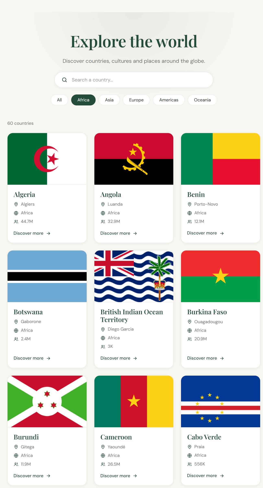
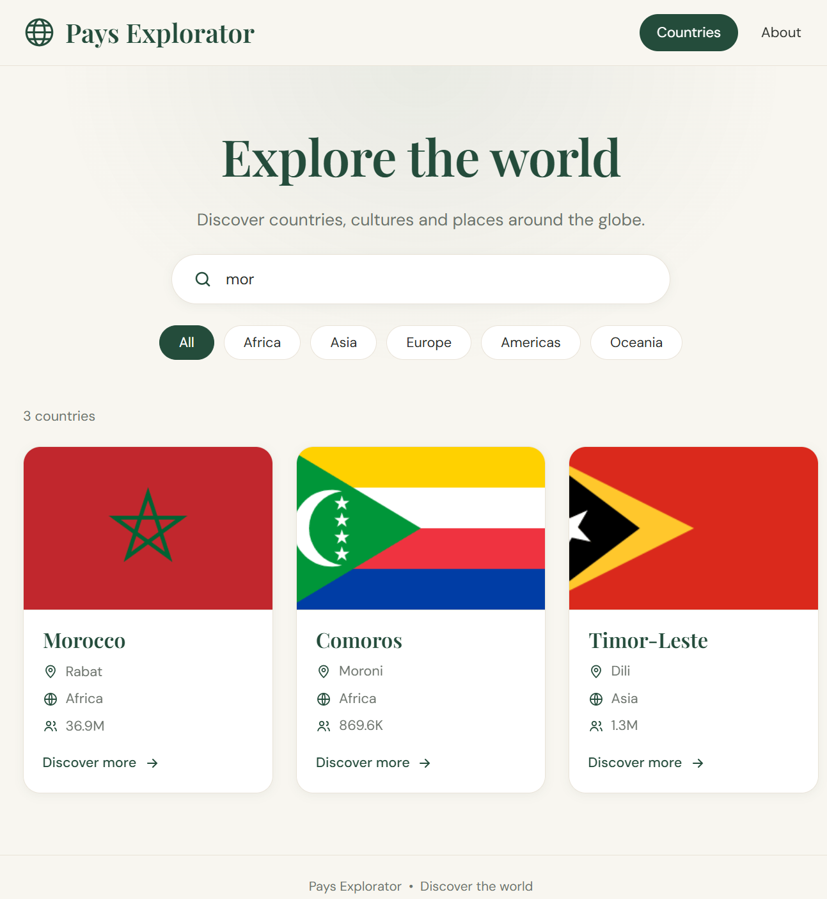
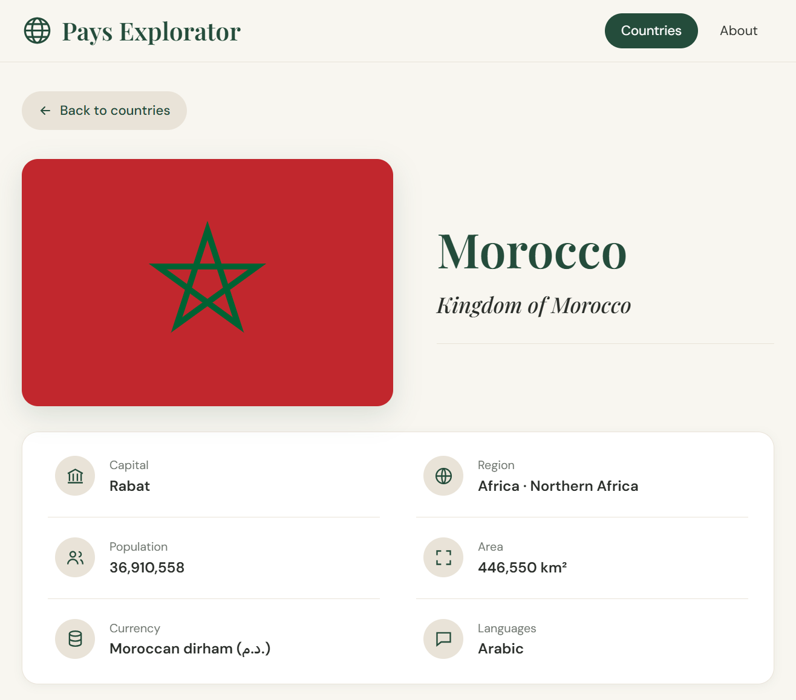
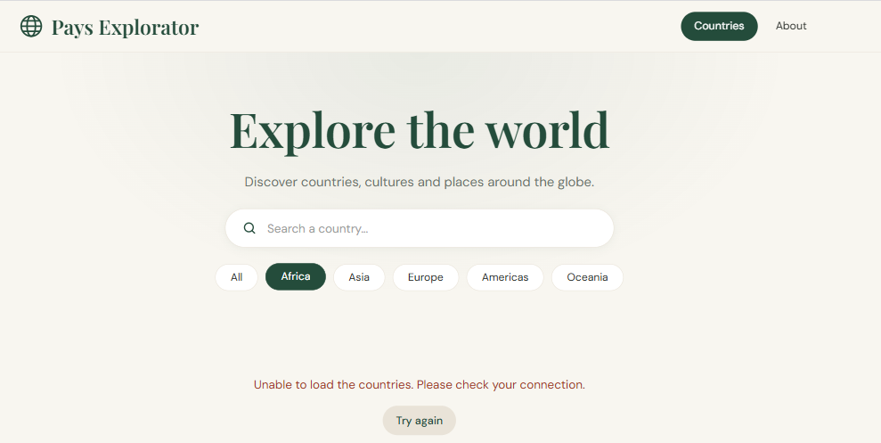

#  Pays Explorator – TP 7 : Explorateur d'API REST

Application web développée avec **Vue.js 3** (Options API) et **Vue Router** dans le cadre du TP 7
(*fetch, chargement, erreurs*).

Elle permet d'explorer les pays du monde : recherche par nom, filtre par région et fiche détaillée
pour chaque pays. Les données sont chargées en direct depuis l'API publique **countries.dev**
(aucune clé d'API nécessaire).

## 📸 Aperçu

### Page d'exploration
Recherche, filtres par région et grille de cartes de pays (ici, filtre « Africa » : 60 pays).



### Recherche dynamique
La recherche « mor » affiche les pays dont le nom contient ce texte. Le Maroc apparaît en premier,
car son nom commence par le texte saisi.



### Fiche détaillée d'un pays
Drapeau, nom officiel, capitale, région, population, superficie, monnaie, langues et pays voisins.



### Gestion des erreurs
Lorsque l'API ne répond pas correctement, l'application affiche un message clair et un bouton
« Try again » pour relancer le chargement.



## ✨ Fonctionnalités

- **Liste des pays** chargée au montage du composant avec `fetch` et `async/await`.
- **Recherche dynamique** par nom (insensible à la casse). Les noms qui commencent par le texte saisi apparaissent en premier.
- **Filtres par région** : All, Africa, Asia, Europe, Americas, Oceania (combinables avec la recherche).
- **Page détail** (`/pays/:code`) chargée séparément à partir du code du pays (ex. `/pays/MAR`).
- **Pays frontaliers cliquables** : on passe d'un pays à l'autre sur la même vue.
- **Page About** et navigation par Vue Router.
- **Design sobre et aéré** (vert forêt, crème, typographie serif pour les titres).

## 🔄 Gestion des trois états du chargement

| État | Variable | Affichage |
|---|---|---|
| En cours | `loading = true` | Spinner « Loading countries... » |
| Réussi | `countries` rempli | Grille de cartes |
| En erreur | `error` contient un message | Message d'erreur + bouton « Try again » |

Le schéma utilisé dans `chargerPays()` :

```js
async chargerPays() {
  this.loading = true
  this.error = null
  try {
    const reponse = await fetch(API_URL)
    if (!reponse.ok) throw new Error(`Erreur ${reponse.status}`)
    this.countries = extraireListe(await reponse.json()).map(normaliser)
  } catch (e) {
    this.error = 'Unable to load the countries.'
  } finally {
    this.loading = false
  }
}
```

> `fetch()` ne rejette que sur une panne réseau. Une réponse 404 ou 500 est une réponse « réussie »
> pour la promesse : c'est pourquoi on teste `reponse.ok` et on lance l'erreur avec `throw`.

**Bonus** : un `watch` sur `$route.params.code` recharge la fiche quand on clique sur un pays voisin
(Vue Router réutilise le même composant, donc `mounted` ne se redéclenche pas).

## 🗂️ Structure du projet

```
src/
├── main.js
├── router.js                  # routes : /, /pays/:code, /about
├── api.js                     # URL de l'API, normalisation des données, formatage
├── App.vue
├── assets/main.css            # variables de couleurs et styles globaux
├── components/
│   ├── AppHeader.vue          # logo + navigation
│   ├── SearchBar.vue          # barre de recherche
│   ├── RegionFilter.vue       # filtres par région
│   ├── CountryCard.vue        # carte d'un pays
│   ├── FlagImage.vue          # drapeau avec image de secours (émoji)
│   ├── InfoItem.vue           # bloc d'information de la fiche détail
│   └── StateMessage.vue       # chargement / erreur
└── views/
    ├── CountryListView.vue    # page liste (recherche + filtres)
    ├── CountryDetailView.vue  # page détail d'un pays
    └── AboutView.vue
```

## 🚀 Installation et lancement

Prérequis : **Node.js** (version LTS) et **npm**.

```bash
npm install
npm run dev
```

Puis ouvrir l'adresse affichée dans le terminal (généralement `http://localhost:5173`).

Pour vérifier que le projet compile :

```bash
npm run build
```

## 🛠️ Technologies

- Vue.js 3 (Options API)
- Vue Router 4
- Vite
- API REST : [countries.dev](https://countries.dev/countries)

## 👥 Réalisé par

- *Chaimaa benradouan*
- *Hiba benguara*

Encadrant : Pr. Ahmed Bentajer – ENSA Safi
